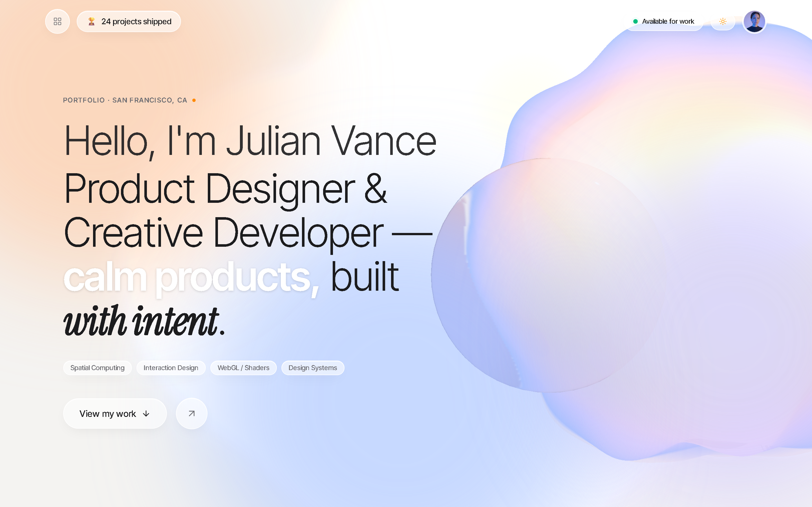

# Ujjwal Sitaram Arote — Apple-Inspired Tactile Glassmorphic 3D Portfolio

> An authentic personal portfolio inspired by visionOS, macOS Sequoia, and Apple Human Interface Guidelines (HIG). Centered around a real-time 3D hero iridescent breathing orb with optical glass refraction, bento work grid, and GSAP scroll choreography.



---

## 🌟 Key Features & Apple Aesthetic Pillars

### 1. Tactile Glassmorphic Design System
- **Layered Frosted Glass (`blur(28px)`)**: Translucent background blurring with saturated backdrops.
- **Micro-Noise Texture (2.5%)**: Apple-grade subtle grain overlay creating tactile material feel.
- **Top Highlight Hairlines**: Subsurface scattering rim highlights (`inset 0 1px 0 rgba(255, 255, 255, 0.7)`).
- **Dual Lighting Themes**:
  - **Daylight**: Soft glowing sunrise canvas (`#F4F3F1`) with peach, lavender, and periwinkle optical tones.
  - **Night**: Deep midnight canvas (`#0A0A0C`) with nocturnal magenta, cobalt, and mint luminescent accents.

### 2. Interactive Real-Time 3D Hero
- **Simplex Noise Vertex Breathing**: 3D mesh displaced smoothly via organic simplex noise algorithms in GLSL.
- **Thin-Film Iridescence Fragment Shader**: Dynamic Fresnel rim reflections shifting from peach to lavender, periwinkle, and milky white.
- **Optical Glass Lens Refraction**: A convex transmission glass wafer with chromatic dispersion and dynamic IOR.
- **Interactive Tilt & Pointer Physics**: Smoothly leans and tracks mouse movements using damped spring physics.
- **GSAP ScrollTrigger Choreography**:
  - **Hero**: Floats prominently on the right, refracts light.
  - **About**: Glides gracefully left and warms in tone as profile details slide in.
  - **Work**: Recedes into the depth (`z = -3.2`), scaling up to become an ambient luminescent glow field behind the Bento grid.
  - **Contact**: Re-centers into an intimate glowing signature backdrop.
- **Reduced Motion & WebGL Fallbacks**: Respects `prefers-reduced-motion` and devices without WebGL using optimized CSS radial gradients.

### 3. Complete Portfolio Sections
- **Top Bar**: Shipped projects badge, live availability indicator beacon, Daylight/Night toggle, and quick-links trigger.
- **Summary Strip**: Dot-matrix counter numbers in **Doto** font for years of experience, shipped products, patents, and design system scale.
- **Profile About Card**: VisionOS frosted glass card with holographic signature, design philosophy, and quick action chips.
- **Selected Work (Bento Grid)**:
  - 3D perspective mouse tilt with dynamic light sheen.
  - Blur-to-sharp image reveal on hover (`blur(28px)` to crisp photo).
  - Categorical technology pills and technical MOD year dial marks.
- **Shared-Element Project Detail Modal**:
  - VisionOS modal sheet with dark backdrop blur.
  - Interactive multi-shot carousel with thumbnail navigation and keyboard shortcuts (`Esc`, `←`, `→`).
  - Architecture breakdown, impact metrics, and outbound links.
- **Floating Skills Marquee**: Dual-speed kinetic marquee capsules with categorical status badges.
- **Experience Timeline**: Glowing scroll-tracked progress spine with tactile company cards.
- **Contact Section & Quick Email Copy**: Glass pill inputs, capsule submit button with animated `+` expander, and toast notifications.
- **VisionOS Floating Dock**: Persistent bottom navigation pill with a sliding optical glass bubble indicator tracking active sections.

---

## 🛠 Tech Stack

- **Framework**: [React 19](https://react.dev/) + [Vite](https://vite.dev/) + [TypeScript](https://www.typescriptlang.org/)
- **Styling**: [Tailwind CSS v4](https://tailwindcss.com/) with `@tailwindcss/vite`
- **3D Graphics & Shaders**:
  - [Three.js](https://threejs.org/)
  - [@react-three/fiber](https://r3f.docs.pmnd.rs/)
  - [@react-three/drei](https://github.com/pmndrs/drei)
  - [@react-three/postprocessing](https://github.com/pmndrs/postprocessing)
- **Animation & Scroll Choreography**:
  - [GSAP](https://gsap.com/) + [ScrollTrigger](https://gsap.com/docs/v3/Plugins/ScrollTrigger/)
  - [Framer Motion](https://www.framer.com/motion/)
  - [Lenis](https://lenis.darkroom.engineering/) (Smooth Scroll)
- **Icons & Effects**:
  - [Lucide React](https://lucide.dev/)
  - [Canvas Confetti](https://www.npmjs.com/package/canvas-confetti)
- **Automated Verification**:
  - [Puppeteer Core](https://pptr.dev/) (Visual regression and multi-viewport screenshots)

---

## 🚀 Getting Started

### Prerequisites
- Node.js 18.0 or higher
- npm or pnpm or yarn

### Installation
```bash
# Clone the repository
git clone <repository-url>
cd apple-glass-portfolio

# Install dependencies
npm install
```

### Development Server
```bash
npm run dev
```
Open [http://localhost:5173](http://localhost:5173) in your browser.

### Production Build & Preview
```bash
# Type check and build minified production bundle
npm run build

# Preview production build locally
npm run preview -- --port 4173
```

---

## 📁 Project Architecture

```
apple-glass-portfolio/
├── src/
│   ├── components/
│   │   ├── layout/             # TopBar, FloatingDock, QuickLinksSheet
│   │   ├── sections/           # Hero, SummaryStrip, AboutCard, SelectedWork,
│   │   │                       # ProjectDetailModal, Skills, Experience, Contact, Footer
│   │   └── ui/                 # GlassCard, GlassPill, IconButton, DotMatrixNumber, Toast, CustomCursor
│   ├── hooks/                  # useTheme, useLenis, useMouseDamped, useReducedMotion
│   ├── scene/                  # Three.js Canvas, IridescentOrb, GlassLens, AmbientGlowField,
│   │                           # ScrollChoreographer, PostProcessingEffects
│   ├── shaders/                # Simplex noise GLSL & Thin-film iridescence Fresnel shaders
│   ├── styles/                 # globals.css (Apple glass design tokens, noise texture)
│   ├── types/                  # TypeScript interface contracts for portfolio data
│   ├── content.ts              # Single source of truth for all projects, bio, skills, and links
│   ├── App.tsx                 # Application orchestration root
│   └── main.tsx                # React 19 entrypoint
├── scripts/
│   └── take-screenshots.js     # Automated visual verification suite
└── tailwind.config.js          # Tailwind v4 theme extensions
```

---

## 🎨 Customizing Content

All portfolio content is decoupled and configured in a single, strictly typed file:
[`src/content.ts`](src/content.ts).

To personalize this portfolio:
1. **Bio & Social Links**: Update the `author` object in `src/content.ts`.
2. **Projects & Case Studies**: Add or edit objects in the `projects` array, including carousel images, metrics, and tags.
3. **Metrics Strip**: Modify the `metrics` array to display your personal milestones.
4. **Skills**: Adjust the `skills` categories and lists.
5. **Timeline**: Update the `experience` array with your career history.

---

## 🌐 Deployment Guidelines

### Vercel (Recommended)
```bash
npm install -g vercel
vercel
```
*Vercel will automatically detect Vite and output settings (`dist`).*

### Netlify
1. Connect repository in Netlify dashboard.
2. Build command: `npm run build`
3. Publish directory: `dist`

### Cloudflare Pages
1. Build command: `npm run build`
2. Output directory: `dist`

---

## 📄 License
MIT License. Created with attention to craft and quiet digital luxury.
